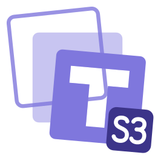

<div align="center">



# TessariDB S3

**Object storage that speaks S3, with its metadata in TessariDB.**

A clustered, S3-compatible object store written in Rust. Objects live on the
storage nodes' drives; every bucket, key, version, upload and policy lives in a
TessariDB cluster.

[](#status)
[](LICENSE)
[](#building)

[tessaridb.com](https://tessaridb.com) · [TessariDB](https://github.com/tessaridb/tessaridb) ·
[docs](https://docs.tessaridb.com)

</div>

> [!NOTE]
> **It stores and lists objects on one node or across a cluster, including objects uploaded in parts.**
> The server verifies SigV4 signatures, keeps buckets and object metadata in TessariDB —
> never object bytes — and every object (up to 5 GiB per PUT) in verified
> data files on the node's drive, or on a cluster erasure-coded as k + m shards across
> the nodes, acknowledged on the write quorum and healed in the background — and answers
> every operation it does not implement `NotImplemented`.
> Release: `0.1.0-beta`, image `tessaridb/s3`. Apart from the
> [Status](#status) section and the items marked as tested below, this page
> describes what the project is for, not a working system.

## What it is for

Unmodified S3 clients — the AWS SDKs, the AWS CLI, `rclone`, backup tools — talk
to it as they would talk to S3. Behind the API it runs as a cluster:

- **Metadata in TessariDB.** Buckets, object versions, multipart uploads, bucket
  policies and cluster membership are records in a TessariDB cluster. The listing
  order, conditional writes and the commit of an object's metadata are that
  database's transactions and indexes, not a second store kept beside it.
- **Data on the storage nodes.** Object bytes are spread across the nodes' drives
  under a stated redundancy rule, and a write is acknowledged only once it is
  durable on its write quorum.
- **One Rust codebase.** Asynchronous I/O on a multi-threaded runtime, with typed
  protocol values from the request parser to the disk.

## The promises it is being designed to keep

These are design commitments. Each will be backed by a test before any release
claims it; the two marked **tested** already are:

- **An operation it does not implement is refused** with `NotImplemented`. It is
  never routed to a neighbouring operation. **Tested:** each of the 116
  operations of the AWS S3 model is signed, sent, and answered `NotImplemented`,
  and an unknown or misplaced parameter is refused before any operation runs.
- **Every signature and every declared checksum is verified.** That covers SigV4
  header, presigned and streaming authentication, and Content-MD5 and the
  `x-amz-checksum-*` family, before a write is acknowledged. Each checksum is
  stored so that a read can return it. **Tested for SigV4:** header, presigned
  and streaming signatures reproduce AWS's published examples, and each example
  altered in one place is refused. The checksum half comes with the object core.
- **Strong read-after-write**, for listings too, with keys listed in byte-wise
  UTF-8 order and continuation tokens that neither skip nor repeat a key.
- **A write is acknowledged only when it is durable** on its quorum, with its data
  and its metadata committed together.
- **Object Lock is enforced wherever data can be deleted**, including lifecycle,
  healing, rebalancing and administration, not only in the API handler.
- **Compatibility is a published matrix**, one row per S3 operation, each marked
  implemented or refused. It is not a claim.

## Status

| | |
|---|---|
| Stage | beta |
| Server | SigV4 (header, presigned, aws-chunked with trailers); buckets and object metadata in TessariDB, every object's bytes in data files whatever its size — none in the metadata (BLAKE3 per 1 MiB block, verified on every read; a store from an earlier build has its small objects moved out at start): CreateBucket, HeadBucket, DeleteBucket, ListBuckets, GetBucketLocation, GetBucketLifecycleConfiguration, PutBucketLifecycleConfiguration and DeleteBucketLifecycle (rules by prefix with Expiration Days/Date/ExpiredObjectDeleteMarker, NoncurrentVersionExpiration with NewerNoncurrentVersions, AbortIncompleteMultipartUpload; transitions and tag or size filters refused `NotImplemented`; applied by a background pass on every node — each bucket with rules is handed to one node at a time through a queue in TessariDB and is due again an hour after each pass; a period runs to the next midnight UTC after its days are up; a current object is expired only while it is still the write that was judged, leaving a delete marker in a versioned bucket), GetBucketNotificationConfiguration and PutBucketNotificationConfiguration (QueueConfiguration only; by default the destination is the metadata store's own `s3_notifications` topic, named `arn:tessaridb:sqs:::tessaridb` and needing no setting — a destination the operator declared (a Kafka topic or a webhook) is the alternative, named `arn:tessaridb:sqs:::<id>`; events `s3:ObjectCreated:*|Put|Copy|CompleteMultipartUpload`, `s3:ObjectRemoved:*|Delete|DeleteMarkerCreated`, `s3:LifecycleExpiration:*|Delete|DeleteMarkerCreated`, a prefix and a suffix filter; an undeclared destination, an unsupported event or overlapping rules are refused `InvalidArgument`, topic, function and event-bus configurations `NotImplemented`; every change in a configured bucket is recorded in TessariDB in the change's own commit and delivered as an S3 event record — into `s3_notifications` once per event (a consumer reads it with a topic group), or to a declared Kafka topic (keyed by `bucket/key`) or webhook at least once — from any node, a refused delivery retried after a growing wait and given up to a dead-letter topic after 8 tries; the sequencer is the event's position), GetBucketReplication, PutBucketReplication and DeleteBucketReplication (the `Filter` form: a prefix, a priority, delete markers, a destination bucket by ARN — both buckets versioned; tag filters and the other options refused `NotImplemented`; each version a rule covers is queued in its own commit, answers `x-amz-replication-status`, and is sent by any node to the destination region's advertised endpoint as the Role's user (`arn:aws:iam::<account>:role/<user>`, who must administer the destination), keeping its version id — retried after a growing wait, `FAILED` after 10 tries; replicas are never sent on; a replicating bucket cannot suspend versioning; root fails a region over to another from the console and restores it, each under the next epoch — meanwhile the region refuses client writes `ServiceUnavailable` and still takes replicas), GetBucketVersioning and PutBucketVersioning (never versioned → Enabled ↔ Suspended, never back; MFA delete refused; an enabled bucket keeps every version and a delete adds a marker, a suspended one replaces only the null version, GetObject and HeadObject answer `x-amz-version-id`, and a bucket holding only versions is not empty; objects from an earlier build become null versions at start; DeleteObject with `versionId` (and a DeleteObjects entry's `VersionId`) removes that version for good — the next newest becomes current, removing a delete marker brings the object back — and needs who administers the bucket; GetObject and HeadObject with `versionId` read that version — an id naming none is `NoSuchVersion`, a delete marker named by id answers 405 and a current one 404 with `x-amz-delete-marker`; ListObjectVersions lists every version and delete marker — keys in byte order, each key newest first with `IsLatest`, paged by key-marker and version-id-marker, rolled up at a delimiter), GetBucketEncryption, PutBucketEncryption and DeleteBucketEncryption (AES256, or aws:kms under a key this node holds; it seals every PutObject, CopyObject and CreateMultipartUpload that asks for no encryption, and a request's own header wins; dual-layer KMS and allowing customer keys `NotImplemented`), GetObjectLockConfiguration and PutObjectLockConfiguration (a bucket created with `x-amz-bucket-object-lock-enabled`, or a versioned one, keeps Object Lock and its versioning for good; a default retention in days or years), GetObjectRetention, PutObjectRetention, GetObjectLegalHold and PutObjectLegalHold (COMPLIANCE is extended and never shortened or removed by anyone; GOVERNANCE yields only to who administers the bucket and sends `x-amz-bypass-governance-retention: true`; a legal hold keeps a version until released — enforced by the metadata store on every path that deletes or rewrites a version, lifecycle included, answering `AccessDenied`; a simple delete still adds a marker; event holds `NotImplemented`), PutObject (`x-amz-tagging`), CopyObject (up to 5 GiB, COPY/REPLACE metadata, copy-source conditions, a checksum recomputed and checked; `x-amz-tagging-directive` COPY/REPLACE; `x-amz-object-lock-*` headers, a retention needing Content-MD5 or a checksum), GetObject, HeadObject, GetObjectTagging, PutObjectTagging and DeleteObjectTagging (a version by `versionId` or the current one; at most 10 tags, keys ≤ 128 and values ≤ 256 characters of letters, digits, spaces and `+ - = . _ : / @`, no `aws:` keys — else `InvalidTag`; GetObject and HeadObject answer `x-amz-tagging-count`; a retained version's tags still change), GetBucketTagging, PutBucketTagging and DeleteBucketTagging (at most 50; none is `NoSuchTagSet`), DeleteObject, DeleteObjects, ListObjectsV2, ListObjects (byte order, delimiter roll-up, authenticated continuation tokens, `encoding-type=url`), CreateMultipartUpload (`x-amz-tagging` kept for completion; Object Lock headers `NotImplemented`; the bucket default applies at completion), UploadPart, UploadPartCopy (a range or all of a source), ListParts, AbortMultipartUpload, CompleteMultipartUpload (multipart ETag, full-object or composite checksum; reads across parts, Range and `partNumber`), ListMultipartUploads (by key and initiation, key and upload-id markers, delimiter roll-up); every other operation `NotImplemented`; per-bucket byte and object quotas, checked on every write that adds (PutObject, CopyObject, UploadPart, UploadPartCopy, CompleteMultipartUpload) against the last usage measurement plus the write — so a bucket can pass its limit by what is written within one usage interval — and refused `InvalidRequest` "bucket quota exceeded" — a limited bucket whose last measurement is older than two usage intervals (or missing) is counted on the write path instead (through its index, refused `ServiceUnavailable` if the count takes over 2 s), with a warning logged and the sizes marked stale in the console; one-key upload credentials — issued by a user who may write the bucket, they upload exactly one key (a single PUT or every step of a multipart upload of it) and nothing else, stop at their expiry (60 s to 7 days), and work only while their issuer may still write there; on a cluster (`TESSARIDB_S3_ERASURE`): RS(k, m) shards one per node, write quorum k (k + 1 when k = m), reads from any k verified shards, background healing (one node at a time per object, under a claim in TessariDB; shard bytes no object can reach are swept), the internal surface over mutual TLS, serving only admitted members — tested with a node killed mid-write and mid-read and the metadata leader killed; image renditions from a bucket's media rules — JPEG, PNG, WebP or AVIF fitted into the listed sizes, never enlarged, written as ordinary objects under `<key>.renditions/` (a rendition never gets renditions); every node plans the objects the metadata store's `media` group hands it into tasks in the `media_images` queue, any node's workers render them, a failed one is tried again after a growing wait and stays listed after five tries; video renditions (MP4: H.264 High, 4:2:0, AAC, index first; WebM: VP9, 4:2:0, Opus; the shorter side at the listed height, never enlarged) and posters (a representative frame, fitted and encoded like an image) are made from `media_videos` by nodes given an ffmpeg — run as its own process, never linked, stopped after 50 minutes; a node restarted under its name takes back the tasks it held at once |
| Console | a web page on its own listener (sign-in, overview with stored bytes and drive space, buckets with their size — logical and on the drives (with erasure overhead) —, object browser (each key with its type as stored at write, size, age and ETag; a selected key's headers, user metadata, tags, checksums, retention and legal hold in a side pane, read from its record without opening the object; pages appended by the server's cursor as the list is scrolled, or with "Load more"; a name filter within the open folder, listed by the store as a longer prefix; each row's details, download, copy-key and ETag-guarded delete as icon buttons), downloads, ETag-guarded deletes with reasons, spaces and users with keys shown once (issuing is idempotent: a form submitted twice issues one key, and the repeat shows no secret), each user's keys listed without secrets and revoked with a reason (refused on every node within the 5-second resolution window), and bucket grants, bucket quotas set by operators, each bucket's default encryption (none, the server's key or a named key; a key not held is refused), each bucket's media rules (which content types under which key prefix get which renditions, each picked as kind, size and format — images and poster frames at 150 to 3840 px in JPEG, PNG, WebP or AVIF, videos at 360p to 2160p in MP4 or WebM — seen by whoever reads the bucket, set by whoever configures it, checked as a whole and recorded), upload keys for one object issued from a bucket's row with the secret shown once, a cluster view for keys allowed to see it — where root admits nodes, issues one-time join tokens and removes nodes, and stages a layout as erasure sets of registered nodes and applies it as the next version, refused if it changed meanwhile —, the renditions that failed for good with their tries and last error (operators), the action record; menus show only what the signed-in key may use; light and dark) over a JSON API |
| Releases | `0.1.0-beta`, `0.0.1-alpha` |
| Licence | BUSL-1.1 (see [Licence](#licence)) |

## Building

A Cargo workspace on Rust 1.98 (edition 2024). It builds the server, `tessaridb-s3`, and a load generator for it,
`tessaridb-s3-bench` (see [Measuring](#measuring)).

```sh
cargo build --workspace
cargo fmt --all --check
cargo lint        # clippy on every target and feature, warnings denied
cargo t           # every library and integration test
cargo deny check
```

## Running

The metadata store is a TessariDB node, `0.33.4-beta` or later (`tessaridb/tessaridb:0.34.2-beta`): the listings page
with a bound record cursor and every row count is bound, which earlier releases refuse. The process reads its configuration from the environment:

| Variable | Default | Meaning |
|---|---|---|
| `TESSARIDB_S3_ROOT_ACCESS_KEY` | — (required) | the root credential's access key |
| `TESSARIDB_S3_ROOT_SECRET_KEY` | — (required, ≥ 16 bytes) | the root credential's secret |
| `TESSARIDB_S3_LISTEN` | `127.0.0.1:9100` | the address the S3 API listens on |
| `TESSARIDB_S3_TLS_CERT` / `_KEY` | unset (plain) | the S3 API over TLS: its certificate chain and private key (PEM), both or neither; TLS 1.2 and 1.3 only |
| `TESSARIDB_S3_REGION` | `us-east-1` | the region requests must be signed for; its buckets' objects are kept in the database `<database>_<region>`, and a request for another region's bucket is answered `301 PermanentRedirect` |
| `TESSARIDB_S3_DOMAINS` | empty | comma-separated endpoint domains for `<bucket>.<domain>` addressing; path-style always works |
| `TESSARIDB_S3_MAX_INFLIGHT` | `1024` | requests served at once before new ones get `503 SlowDown` |
| `TESSARIDB_S3_SHUTDOWN_GRACE_SECS` | `30` | how long in-flight requests get after SIGTERM |
| `TESSARIDB_S3_META_ADDRESS` | — (required) | the TessariDB nodes holding the metadata, `host:port` of each wire surface, comma-separated; a node that does not answer within 5 s is passed over for the next |
| `TESSARIDB_S3_META_REPLICATION` | `none` for one node; required for several | copies the metadata cluster keeps of the namespace: a number, or `none` — a cluster refuses a namespace whose replication was never stated |
| `TESSARIDB_S3_META_USER` / `_PASSWORD` | — (required) | the TessariDB user the server signs in as — its own account, an editor of its namespace (`DEFINE USER s3 ON NAMESPACE s3 ROLE editor`), never the owner |
| `TESSARIDB_S3_META_NAMESPACE` / `_DATABASE` | `s3` / `meta` | where the metadata lives; the database is created on start-up, the namespace only by an account allowed to (the operator declares it with the server's account) |
| `TESSARIDB_S3_META_CA` | unset | a PEM certificate authority to verify the node's TLS against; unset speaks in the clear |
| `TESSARIDB_S3_META_MAX_CONNECTIONS` | `32` | connections to the metadata store; at most 4 new ones sign in at once, because a node verifies at most 24 passwords at once for all its clients — a sign-in it still declines answers `503 SlowDown` |
| `TESSARIDB_S3_META_STATEMENT_TIMEOUT_SECS` | `30` | how long a metadata statement may wait for its answer; past it the request answers `503` and a write's data stays queued, because the statement may have committed |
| `TESSARIDB_S3_DATA_DIR` | required | where every object's bytes are stored (`<dir>/s3data/…`); unset, the node refuses to start |
| `TESSARIDB_S3_RECLAIM_GRACE_SECS` | `86400` | how long a replaced, deleted or abandoned data file is kept before the reclaimer removes it; recorded in the metadata store at start and applied to files queued from then on |
| `TESSARIDB_S3_RECLAIM_INTERVAL_SECS` | `300` | time between reclamation passes |
| `TESSARIDB_S3_USAGE_INTERVAL_SECS` | `60` | time between passes measuring each bucket's objects and bytes; every node runs one and one member measures per pass |
| `TESSARIDB_S3_MEDIA_WORKERS` | `2` | image renditions this node makes at once, 0 to 64; `0` makes none here while other nodes still take the queue |
| `TESSARIDB_S3_ADVERTISE` | unset | the URL (`http(s)://host[:port]`) this node's S3 surface is reached at, recorded for its region as where replicas are sent |
| `TESSARIDB_S3_FFMPEG` | unset | the ffmpeg (with libx264, libvpx-vp9 and libopus) this node runs for video renditions and posters; unset, the node leaves those tasks to a node that has one. Originals are copied to the system temp directory while they are encoded. The published image carries no ffmpeg |
| `TESSARIDB_S3_UPLOAD_MAX_AGE_SECS` | `604800` | how long a multipart upload may stay open (from its initiation) before the reaper aborts it; the reaper runs on the reclamation interval |
| `TESSARIDB_S3_ERASURE` | unset (a node on its own) | the erasure code `k+m` this node's cluster writes objects with (k, m ≥ 1, k + m ≤ 16); setting it makes the node a cluster member and requires the four settings below and `TESSARIDB_S3_DATA_DIR` |
| `TESSARIDB_S3_NODE_ID` | — | this node's name in the cluster: 1–63 lowercase letters, digits and inner hyphens |
| `TESSARIDB_S3_ZONE` | unset (the node is a failure domain of its own) | the failure domain the node is in — a zone, a rack, a room: 1–32 lowercase letters, digits and inner hyphens, registered with the node. A layout never puts more of one object's shards in one zone than its parity can lose, so losing a whole zone leaves every object readable; the first layout takes the registered nodes in id order, passing over a node whose zone already holds m shards |
| `TESSARIDB_S3_INTERNAL_LISTEN` | — | where the internal shard surface listens: the other nodes store, read and remove this node's shards there. A request is served only when the certificate it presents is issued for the node it names and that node is an admitted member; a removal reaches every node within 5 seconds |
| `TESSARIDB_S3_INTERNAL_ADVERTISE` | — | `host:port` the other nodes reach that surface at; registered in the metadata on start-up |
| `TESSARIDB_S3_CLUSTER_SECRET` | — | key objects are placed on the erasure sets by, at least 32 bytes, the same on every node |
| `TESSARIDB_S3_INTERNAL_TLS_CERT` / `_KEY` / `_CA` | — | the internal surface over mutual TLS, required: this node's certificate chain (PEM, issued for `<node id>.peer.tessari-s3`), its private key, and the cluster's certificate authority. A node whose certificate is issued for another name does not start, and a call reaches another node only when its certificate is issued for the node dialled; TLS 1.2 and 1.3 only |
| `TESSARIDB_S3_FOUNDING_MEMBERS` | unset | node ids, comma-separated, admitted at start where they have no membership record yet — how a new cluster begins; a removed node is never admitted again |
| `TESSARIDB_S3_JOIN_TOKEN` | unset | a one-time token issued in the console for this node; offered at start, it binds this node's certificate. A node that is not an admitted member does not start |
| `TESSARIDB_S3_HEAL_INTERVAL_SECS` | `60` | time between healing passes on a cluster member: each rewrites the missing or damaged shards of objects listed for healing |
| `TESSARIDB_S3_MOVE_BYTES_PER_SEC` | `33554432` | bytes a second a cluster member copies when it moves objects onto a newly applied layout; `0` pauses moving |
| `TESSARIDB_S3_IAM_KEY` | unset (no user keys) | 64 hexadecimal digits: the root from which each space's key for sealing users' access-key secrets is derived. Without it no key can be issued or resolved, so only the root credential signs in. Keep it like the root secret; a node that loses it can open no user's key |
| `TESSARIDB_S3_KEYS_PASSPHRASE` | unset (sealed until an operator unseals in the console) | the passphrase that unseals the keys objects asked for with `x-amz-server-side-encryption: AES256` or `aws:kms` are sealed under, at least 15 characters; the unsealed keys live only in this process's memory |
| `TESSARIDB_S3_NOTIFY_TARGETS` | unset (only the database's own topic) | Alternative destinations bucket notifications may name, separated by `;`: `<id>=kafka:<host:port>[,<host:port>…]/<topic>` (the topic must exist) or `<id>=webhook:<http(s) URL>`. A bucket's configuration names one only by `arn:tessaridb:sqs:::<id>`, never by an address, so a bucket administrator cannot point the server at a host of their choosing; `tessaridb` is the built-in topic's id and cannot be declared |
| `TESSARIDB_S3_CONSOLE_LISTEN` | unset (no console) | where the operator console listens, on its own address apart from the S3 API. Signing in takes an access key and its secret — the root key, or a key issued to a user — and gives a one-hour session cookie (HttpOnly, SameSite=Strict); every other console route needs it |
| `TESSARIDB_S3_CONSOLE_TLS_CERT` / `_KEY` | unset (plain) | the console over TLS: its certificate chain and private key (PEM), both or neither. Without them a secret crosses the network in the clear when an operator signs in, so keep the console on a private address; the node says so when it starts |
| `TESSARIDB_S3_CONSOLE_SIGN_INS_PER_MINUTE` | `10` | sign-in attempts accepted per client address per minute; the limit is checked before the credential |
| `TESSARIDB_S3_CONSOLE_REQUESTS_PER_MINUTE` | `600` | console requests accepted per signed-in key per minute |
| `TESSARIDB_S3_CONSOLE_OIDC_ISSUER` | unset (keys only) | an OpenID Connect provider people sign in to the console through, by its issuer URL (https, or http to this machine only). Its four companions are then required or defaulted; set without the issuer they are refused |
| `TESSARIDB_S3_CONSOLE_OIDC_CLIENT_ID` / `_CLIENT_SECRET` | — | the console's client at the provider; the secret stays on the server (`client_secret_basic`) |
| `TESSARIDB_S3_CONSOLE_OIDC_REDIRECT_URI` | — | the callback registered at the provider, exactly: the console's address followed by `/api/v1/auth/oidc/callback` |
| `TESSARIDB_S3_CONSOLE_OIDC_MFA_AMR` | `mfa` | comma-separated `amr` values that prove a second factor; a sign-in whose ID token carries none of them is refused |
| `TESSARIDB_S3_CONSOLE_BREAK_GLASS_WEBHOOK` | unset (no alert) | where a root sign-in to the console is announced as it happens: one JSON POST (`event`, `key_id`, `reason`, `client`, `expires`), over https or http to this machine. Needs `TESSARIDB_S3_CONSOLE_OIDC_ISSUER` |
| `TESSARIDB_S3_CONSOLE_KEY_SIGN_IN` | `all` | which access keys open a console session beside an identity provider: `all` — any live key; `root` — people sign in through the provider only, a user's key is refused with `key_sign_in_disabled` (a session it opened earlier ends at its next request) and the root key stays as the emergency path. The S3 API is not affected. Needs `TESSARIDB_S3_CONSOLE_OIDC_ISSUER` |

The server applies its metadata schema on start-up and does not start without
the metadata node. Anonymous requests are refused. SIGINT or SIGTERM stops the
server after the grace period.

With `TESSARIDB_S3_CONSOLE_LISTEN` set, the node also serves the operator console: open that address in a browser
and sign in with an access key — the root key, or one issued to a user. The page needs nothing from the network — no font, no script from anywhere
else — and runs only its own script under a strict content security policy. Everything it does goes through the
JSON API under `/api/v1`, which can be called directly. After signing in (`POST /api/v1/session`) an operator can read the node's
status — this node's data drive (capacity, free, available) and, on a cluster member, its members, whether each answers,
the space of each one's drive, and how many objects wait for healing — read how many objects and bytes each bucket holds
(`GET /api/v1/usage`, as of the last measurement, with its time) — list, create and delete buckets,
list a bucket a page at a time, describe an object, download it (always as an attachment) and delete it under the
ETag they saw: a changed object answers `412` and is kept. Every change and every download is recorded with the
signed-in key and the operator's reason, required to delete; `GET /api/v1/actions` reads that record newest first.
It is kept a year in TessariDB, which refuses to change or remove an entry.

With an identity provider configured, a person signs in at `/api/v1/auth/oidc/start` instead of with a key: the
authorization code flow with PKCE (`S256`), the console server holding every token and the browser only its session
cookie. The return is checked in full — the state taken once, the `iss` response parameter, the code exchanged once,
the ID token's signature (RS256, ES256 or EdDSA from the provider's published keys, never an algorithm the token or
the provider's metadata names), issuer, audience, expiry, nonce and `at_hash`, and a second factor — and the identity
must be linked to a user (`PUT /api/v1/users/{user}/identity` with the provider's `subject`, by whoever may manage
that user, recorded like any change). Every refused return is the same `401`; the reason is in the node's log. The
session holds the user, not a key, and ends at its next request once the user is disabled.

The sign-in page asks `GET /api/v1/auth/methods` (no session needed; `{"provider": true|false, "keys": "all"|"root"}`) and, with a provider
configured, offers "Sign in with your organisation" as its main action — it starts at
`/api/v1/auth/oidc/start?fresh=true`, so a person arriving there may act on privileged pages right away — with the
access-key form below it — or, with `TESSARIDB_S3_CONSOLE_KEY_SIGN_IN=root`, behind an "Emergency sign-in with the root
key" link, since no other key opens a session there. A root sign-in the server answers with `reason_required` opens a reason field on the same
form, and a privileged act refused with `reauthentication_required` tells the operator to sign in again.

Beside an identity provider, signing in with the root credential is the emergency path. It owes a `reason`, and the
session lasts 15 minutes instead of an hour. The sign-in is recorded in the action record (`break_glass_sign_in`)
before the session exists; a record that cannot be written refuses the sign-in. When a webhook is configured, the
sign-in is announced to it as it happens. An alert that cannot be delivered does not bar the path: it is logged and
the record's outcome says `alert_failed`. Without an identity provider, root signs in as before.

Privileged acts need a recent sign-in: issuing a key or an upload key, linking an identity, setting or removing a
grant, setting a quota and deleting a bucket are refused with `401 reauthentication_required` when the operator last
authenticated more than five minutes ago. Other requests continue under the same session. A key holder authenticates
again by signing in. A person signed in through the provider counts from the ID token's `auth_time` (no `auth_time`
counts as long ago); `/api/v1/auth/oidc/start?fresh=true` asks the provider for `max_age=300`.

A person's console session ends at its next request when any of these happens:
- the user is disabled in the store;
- the identity is unlinked;
- the provider posts an OpenID Connect back-channel logout to `/api/v1/auth/oidc/backchannel-logout`.

The console verifies a logout token like an ID token: the provider's published key, an algorithm from the console's
own list, our issuer and client, issued within the last five minutes, the logout event, a `sub` and no `nonce`. It
acts on each token id once. Measured on a test node, the request after the logout's answer was refused 8 ms later. A
provider that sends no back-channel logout leaves an open session to its lifetime, one hour. Register
`<console>/api/v1/auth/oidc/backchannel-logout` with the provider as the back-channel logout URI.

The page is built from TypeScript in `crates/tessari-s3-api/panel/`; its output is committed to
`crates/tessari-s3-api/assets/` and embedded in the binary, so building the server never needs Node. Only changing
the page does:

```sh
cd crates/tessari-s3-api/panel
npm install
npm run build    # writes ../assets/
npm run verify   # typecheck, unit tests, build; fails if the committed assets differ from what the source builds
```

Never edit `crates/tessari-s3-api/assets/` by hand — the next build overwrites it and `npm run verify` reports it.

The live tests need a TessariDB node; each test works in its own namespace:

```sh
TESSARIDB_S3_TEST_META=127.0.0.1:9080 TESSARIDB_S3_TEST_META_USER=… TESSARIDB_S3_TEST_META_PASSWORD=… \
  cargo test -p tessari-s3-api --test live -- --ignored
```

With the same variables, `cargo test -p tessari-s3-node --test processes -- --ignored`
starts six `tessaridb-s3` processes as one 4+2 cluster and kills some of them. The same command runs the fault
tests, which need Docker and the `tessaridb/tessaridb:0.34.2-beta` image: they start their own three-node
TessariDB cluster, kill an S3 node while a write or a read is in flight and kill the metadata leader under
traffic, then check that every acknowledged object reads back whole and nothing else is visible.

## Measuring

`tessaridb-s3-bench` measures a running server from the client side. Per object-size class (4 KiB, 128 KiB, 1 MiB,
64 MiB, and 256 MiB uploaded in 16 MiB parts) and per concurrency step, it PUTs a set of keys spread over
prefixes, GETs them back, HEADs them, lists them with ListObjectsV2 and deletes them. Each request is signed with
SigV4 and declares its body's SHA-256. Every GET body is compared with what was PUT. A single mismatch marks the run
invalid, and the command then exits non-zero. Latency is recorded from the request leaving to the last byte
arriving. Building and hashing a body happens before the clock starts and is reported as the client's preparation
share.

```sh
cargo build --release -p tessari-s3-bench
TESSARIDB_S3_BENCH_ENDPOINT=127.0.0.1:9100 TESSARIDB_S3_BENCH_ACCESS_KEY=… TESSARIDB_S3_BENCH_SECRET_KEY=… \
TESSARIDB_S3_BENCH_SERVER_BUILD=<image tag or commit> TESSARIDB_S3_BENCH_HOST_NOTE="<hardware, cluster shape>" \
  target/release/tessaridb-s3-bench run          # prints a table, writes bench-<start>.json
target/release/tessaridb-s3-bench summarise bench-*.json   # median and range per phase across runs
```

A run is shaped with `TESSARIDB_S3_BENCH_CLASSES` (`4k,128k,1m,64m,multipart`), `_CONCURRENCY` (`1,4,16,64`),
`_OPS` (1000 per phase; a large class gets fewer, within 4 GiB a phase), `_WARMUP` (50 operations left out at the
start of each phase), `_PREFIXES` (16), `_BUCKET` (`tessaridb-s3-bench`, created if absent) and `_OUT` (the report
directory). A concurrency step that would hold more than 1 GiB of bodies at once is skipped for that class.
`summarise` refuses reports that differ in server build, endpoint, host or workload. Only like-for-like runs are
compared.

## Performance

These are measured numbers for `0.0.1-alpha`, with the conditions they were taken under. They describe one laptop, not a
production deployment.

The set-up was six `tessaridb-s3` processes as one 4+2 cluster on a single Apple-silicon Mac (10 CPUs), speaking
mutual TLS to each other. All six data directories sat on its one internal SSD. The metadata store was a fresh
TessariDB `0.34.2-beta` node in Docker Desktop. Every request went through one node, the release build was used, and reads hit a warm page cache. The
table gives the median of three runs. In every run, each GET returned exactly the bytes that were PUT.

| | 4 KiB | 1 MiB | 64 MiB |
|---|---|---|---|
| PUT, one client | 74 ms | 76 ms | 503 ms |
| PUT, most per second | 25 (from 16 clients) | 24 | 4.3 (≈ 277 MiB/s) |
| GET, one client | 2.4 ms | 3.0 ms | 68 ms |
| GET, most per second | ≈ 1,690 | ≈ 1,390 (MiB/s) | ≈ 30 (≈ 1,900 MiB/s) |
| HEAD, most per second | ≈ 15,200 | ≈ 14,400 | ≈ 10,900 |
| DELETE, one client / most per second | 2.9 ms / ≈ 1,510 | 3.1 ms / ≈ 1,390 | 3.2 ms / ≈ 1,310 |

On this machine, writes are limited by the drive. Every PUT syncs its six shard files, and on macOS each sync flushes
the whole drive's cache. Six "nodes" sharing one drive therefore wait on each other. On an earlier build (before
internal TLS), with the data directories moved to a RAM disk, the 4 KiB PUT took 18 ms and reached 149 per second. A
cluster whose nodes have their own drives is not limited this way, but it has not been measured yet.

On that earlier build, with one node of the six stopped, every request still succeeded. Reads took about twice as long, because a missing
shard is rebuilt from parity on every read. Writes were about 10 % faster, because there was one shard file fewer
to sync.

## In a container

The `Dockerfile` builds an image holding only the `tessaridb-s3` server — no database. Its metadata lives in a
TessariDB node beside it, and `compose.yaml` runs the two together:

```sh
cp .env.example .env        # set every value: the TessariDB owner, the server's own account password, the S3 root key and secret, the IAM key, the keys passphrase
docker compose up -d --wait
aws --endpoint-url http://127.0.0.1:9100 s3 mb s3://first
```

The database (`tessaridb/tessaridb:0.34.2-beta`; a store an earlier image created opens unchanged and keeps its on-disk format until `ALTER STORE FINALIZE FORMAT` — run that only once no older image will open the store again) declares its owner from `.env` on first start and is reachable only
from the S3 server over the compose network. A one-shot `s3-account` step (`docker/s3-account.sh`) signs in as that
owner once to declare the namespace, the database and the server's own account; the server then signs in as `s3`,
an editor of the `s3` namespace that is refused anything outside it. S3 (`9100`) and the console (`9101`) are published on `127.0.0.1`; give
each its certificate, or put a TLS-terminating proxy in front, before exposing either. Both keep their data in named volumes, and the server runs
as a non-root user. The image carries no credential: every required value comes from the environment, and the
server refuses to start without them. The published image is `tessaridb/s3` (linux/amd64 and linux/arm64), distroless
and non-root; `tessaridb-s3 health` is its health check.

## Branches

`dev` is where development happens. `main` will carry releases and move only by
merging `dev` at a release, with each release tagged there.

## Licence

TessariDB S3 is licensed under the [Business Source License 1.1](LICENSE).
Production use is free, including use by and within a commercial company. Two
things need a commercial licence from the Licensor:
- providing TessariDB S3 to third parties as an object storage service;
- selling, reselling, renting or sublicensing it.

On the Change Date in [`LICENSE`](LICENSE) the code converts to the Apache
License, Version 2.0. For other arrangements, write to licensing@tessaridb.com.
